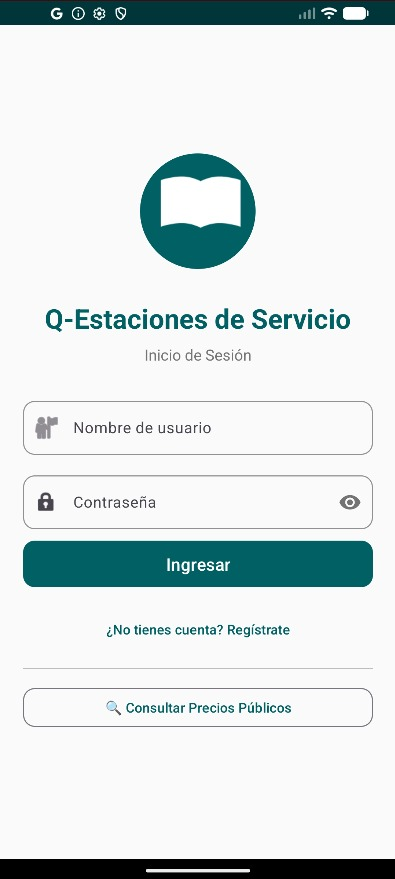
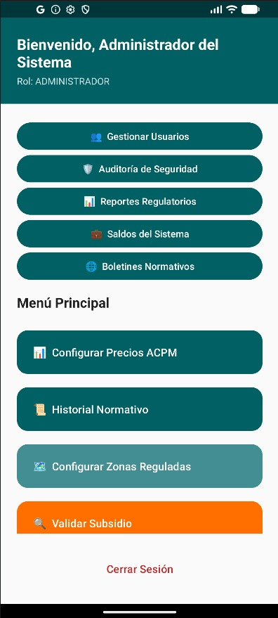
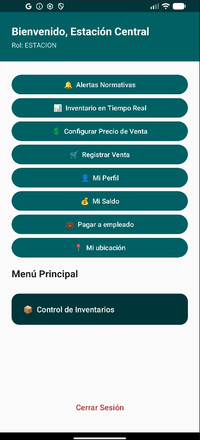
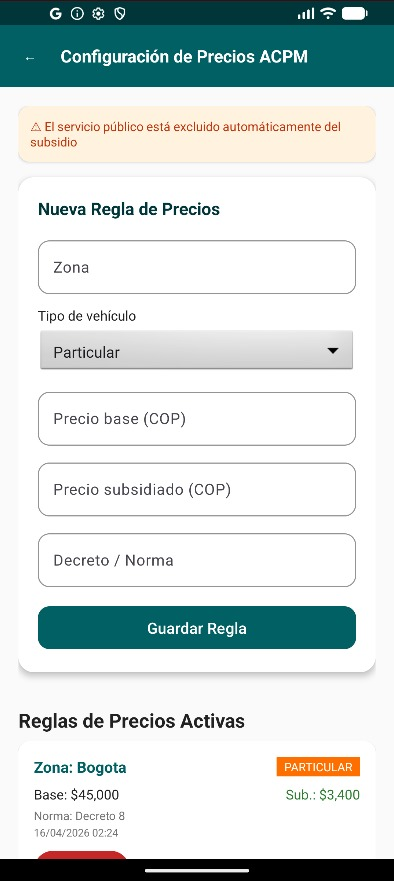
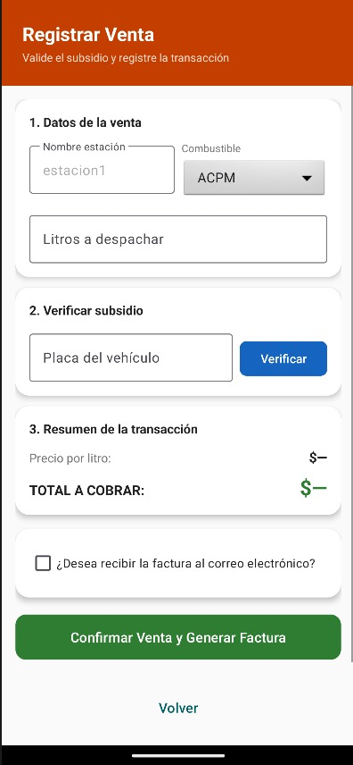
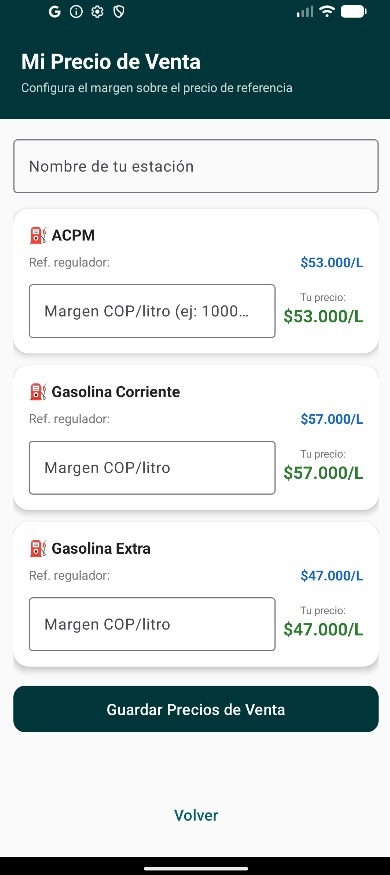
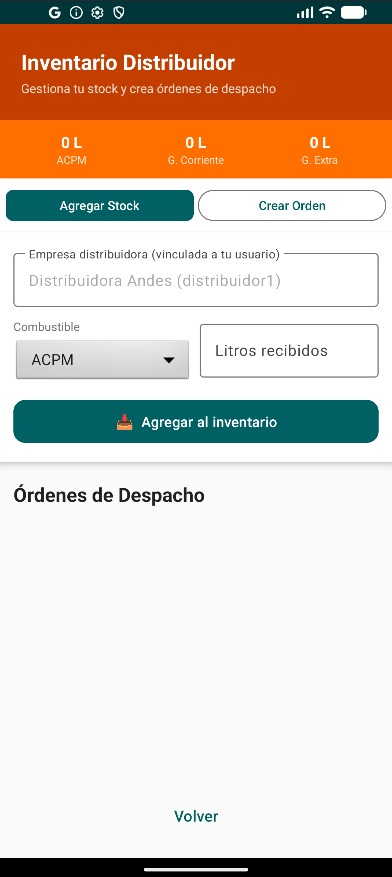
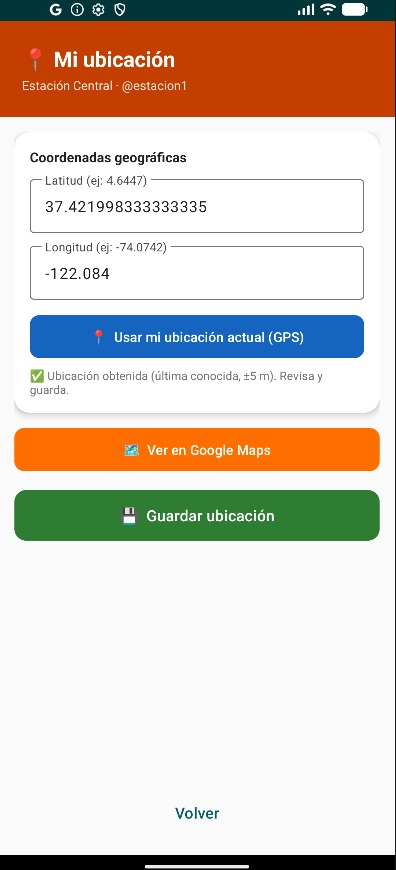

# ⛽ Q-Estaciones de Servicio

Aplicación móvil Android para gestionar la cadena de distribución de combustible: precios regulados, inventario, despachos, ventas, subsidios y reportes regulatorios, con **seis roles** y un menú que se adapta a cada uno.

Proyecto académico de Ingeniería de Sistemas en la Universidad Piloto de Colombia, organizado por historias de usuario (HU).


## Capturas

<table>
  <tr>
    <td align="center"><br><sub>Inicio de sesión</sub></td>
    <td align="center"><br><sub>Menú del administrador</sub></td>
    <td align="center"><br><sub>Menú de la estación</sub></td>
    <td align="center"><br><sub>Reglas de precios por zona</sub></td>
  </tr>
  <tr>
    <td align="center"><br><sub>Venta con validación de subsidio</sub></td>
    <td align="center"><br><sub>Margen sobre el precio de referencia</sub></td>
    <td align="center"><br><sub>Inventario del distribuidor</sub></td>
    <td align="center"><br><sub>Ubicación por GPS</sub></td>
  </tr>
</table>

## Roles

Cada usuario ve solo las funciones de su rol. Las estaciones y los distribuidores tienen sus datos aislados: inventario, precios y ventas propias.

| Rol | Qué puede hacer |
|---|---|
| **Administrador** | Gestiona usuarios, precios, zonas reguladas, subsidios, auditoría de seguridad, reportes y saldos del sistema |
| **Autoridad Reguladora** | Fija precios de referencia y zonas, valida subsidios, consulta la trazabilidad de operaciones y publica boletines normativos |
| **Operador** | Valida subsidios, registra ventas y genera reportes |
| **Estación** | Controla su inventario en tiempo real, configura su precio de venta, registra ventas y recibe alertas normativas |
| **Distribuidor** | Registra entregas a estaciones y gestiona su inventario, despachos y ruta del día |
| **Usuario particular** | Consulta precios, compra combustible, revisa su historial de compras y busca estaciones cercanas |

## Funcionalidades

- **Autenticación con verificación en dos pasos (2FA)**: el código llega al correo por SMTP real, y cada acceso queda registrado en la auditoría.
- **Precios regulados**: precio de referencia, margen por estación, historial normativo y notificación de cambios.
- **Subsidios por placa**: validación contra un servicio de tránsito simulado. Una estación no puede vender con subsidio si la placa no tiene una aprobación previa.
- **Inventario y entregas**: inventario en tiempo real, alertas de stock bajo, registro de entregas de distribuidor a estación y trazabilidad de cada movimiento.
- **Ventas y compras con saldo**: recarga de saldo, compras del usuario particular, pago a empleados y factura enviada por correo.
- **Reportes regulatorios** exportables en **PDF** y **CSV** (compatible con Excel).
- **Mapas**: ubicación de la estación, ruta del distribuidor y estaciones cercanas.
- **Consumo de API REST** con Retrofit + Gson (boletines normativos).
- **Notificaciones** con un servicio en segundo plano (entregas recibidas, subsidios aprobados).

## Tecnologías

| Área | Tecnología |
|---|---|
| Lenguaje | Java 17 |
| Plataforma | Android (minSdk 24, targetSdk 34) |
| Interfaz | Material Components, RecyclerView, CardView |
| Persistencia | Room 2.6 sobre SQLite, con migraciones de esquema versionadas |
| Red | Retrofit 2, Gson, OkHttp |
| Correo | JavaMail (SMTP de Gmail) |
| Reportes | `PdfDocument` de Android y exportación CSV |

## Estructura

El código está organizado **por historia de usuario**, no por capas:

```
app/src/main/java/com/estaciones/qestaciones/
├── PrincipalActividad.java   ← menú dinámico según el rol
├── hu01_autenticacion/       ← login, registro, 2FA, auditoría
├── hu03_precios/             ← precios de referencia y márgenes
├── hu05_subsidios/           ← validación de subsidios por placa
├── hu08_inventario/          ← ventas e inventario en tiempo real
├── hu09_entregas/            ← entregas del distribuidor
├── hu11_reportes/            ← reportes PDF y CSV
├── hu14_usuario_particular/  ← compras e historial del cliente
├── hu16_mapas/               ← ubicación, rutas y estaciones cercanas
├── hu17_red/                 ← consumo de API REST
├── hu18_servicios/           ← notificaciones en segundo plano
├── modelo/                   ← entidades de Room
└── datos/                    ← DAOs y base de datos
```

## Cómo ejecutarlo

1. Clona el repositorio y ábrelo en **Android Studio** (requiere JDK 17).
2. Para que funcionen los correos (2FA y facturas), crea una [contraseña de aplicación de Google](https://myaccount.google.com/apppasswords) y añádela a `local.properties`. Ese archivo no se sube al repositorio:
   ```properties
   smtp.correo=tu_correo@gmail.com
   smtp.contrasena=tu_contrasena_de_aplicacion
   ```
3. Ejecuta la app en un emulador o dispositivo. En el primer arranque se crea un usuario administrador de prueba: `admin` / `admin123`.

## Autor

**Alejandro Jiménez Pinzón**, estudiante de Ingeniería de Sistemas · [LinkedIn](https://www.linkedin.com/in/alejandro-jimenez-pinzon/) · [GitHub](https://github.com/Alejo-developer)
